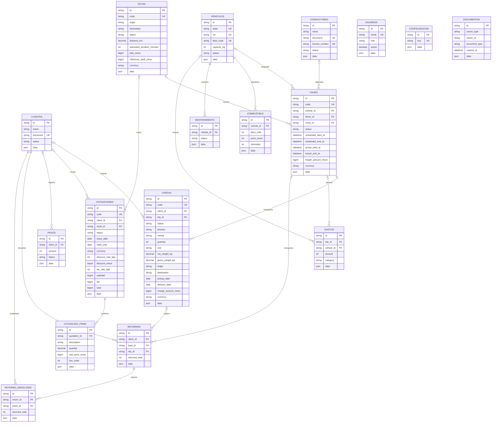

# Base de datos — baseline del Lote 2

Inventario verificado contra MySQL `transporte_frutas` y los modelos SQLAlchemy el 14 de octubre de 2026. La baseline `0001_baseline` crea 17 tablas de aplicación con DDL explícito; `alembic_version` es la tabla de control de Alembic y no una entidad de negocio. Charset/collation de la base: `utf8mb4` / `utf8mb4_unicode_ci`.

## Diagrama entidad-relación

Las relaciones de carga y viaje son intencionalmente uno-a-varios: `cargas.trip_id` referencia al viaje y `viajes.load_id` no existe. El campo `documentos.owner_type/owner_id` es polimórfico y no tiene FK. `usuarios.data.client_id` y los campos de auditoría `created_by` tampoco son FK en este esquema.

## Relaciones y borrado

Las FKs no declaran `ON DELETE`; InnoDB aplica `RESTRICT`/`NO ACTION`. La aplicación usa baja lógica (`deleted_at`) y sus servicios impiden archivar recursos con operaciones activas.

| Origen | Columna | Destino | Borrado físico | Nulo |
|---|---|---|---|---|
| cargas | client_id | clientes.id | RESTRICT | Sí |
| cargas | trip_id | viajes.id | RESTRICT | Sí |
| viajes | vehicle_id | vehiculos.id | RESTRICT | Sí |
| viajes | driver_id | conductores.id | RESTRICT | Sí |
| viajes | route_id | rutas.id | RESTRICT | Sí |
| cotizaciones | client_id | clientes.id | RESTRICT | Sí |
| cotizaciones | route_id | rutas.id | RESTRICT | Sí |
| cotizacion_items | quotation_id | cotizaciones.id | RESTRICT | No |
| combustible | vehicle_id | vehiculos.id | RESTRICT | No |
| mantenimiento | vehicle_id | vehiculos.id | RESTRICT | No |
| gastos | trip_id | viajes.id | RESTRICT | Sí |
| gastos | vehicle_id | vehiculos.id | RESTRICT | Sí |
| pagos | client_id | clientes.id | RESTRICT | Sí |
| retornos | client_id | clientes.id | RESTRICT | No |
| retornos | load_id | cargas.id | RESTRICT | Sí |
| retornos | trip_id | viajes.id | RESTRICT | Sí |
| retorno_desgloses | return_id | retornos.id | RESTRICT | No |
| retorno_desgloses | client_id | clientes.id | RESTRICT | No |

## Unicidad e índices

Listado obtenido de los índices y restricciones de MySQL tras `upgrade head`:

| Tabla | Unicidades | Índices |
|---|---|---|
| clientes | `document` | `name`, `status` |
| conductores | `document`, `license_number` | `name`, `status` |
| vehiculos | `plate`, `vin`, `fleet_code` | `status` |
| rutas | `code` | `name` |
| usuarios | `email` | `role` |
| configuracion | `key` | — |
| documentos | — | `owner_type`, `owner_id`, `document_type`, `expires_at` |
| viajes | `code` | `vehicle_id`, `driver_id`, `route_id`, `status` |
| cargas | `code` | `client_id`, `trip_id`, `status` |
| cotizaciones | `code` | `client_id`, `route_id`, `status` |
| cotizacion_items | `(quotation_id, line_order)` | `quotation_id`, `line_order` |
| combustible | — | `vehicle_id` |
| mantenimiento | — | `vehicle_id`, `status` |
| gastos | — | `trip_id`, `vehicle_id`, `category` |
| pagos | — | `client_id`, `status` |
| retornos | — | `client_id`, `load_id`, `trip_id` |
| retorno_desgloses | — | `return_id`, `client_id` |

Los índices únicos mostrados por MySQL también sirven como restricciones de unicidad. IDs son PK en todas las tablas; las tablas operativas incluyen auditoría (`created_at`, `updated_at`, `created_by`, `deleted_at`) y el campo JSON `data`.

## Preparado para pagos (Lote 3)

El esquema actual aún no tiene asignaciones de pago. El diseño aprobado prevé dos tipos excluyentes: `cobro_cliente`, con cliente y aplicaciones a una o más cargas; y `pago_camion`, asociado a un viaje y a un solo destinatario. Para dividir un flete se registrarán varios pagos del mismo viaje. La implementación y las tablas de aplicación de pagos quedan fuera de este bloque.

## Cómo se reconstruye la base

1. Verificar que `backend/.env` señale `localhost:3306/transporte_frutas` y `APP_ENV=development`.
2. Crear respaldo: `backend/scripts/db_backup/backup.ps1`.
3. Recrear únicamente desarrollo, tras respaldo y confirmación exacta: `backend/scripts/db_backup/recreate-development.ps1 -Confirmation 'CONFIRMO RECREAR transporte_frutas'`. El script valida entorno, host, puerto y nombre, y fija `utf8mb4_unicode_ci`.
4. Aplicar el esquema independiente de los modelos: desde `backend/`, ejecutar `python -m alembic upgrade head`.
5. Crear usuarios locales: `python seed_demo_users.py`.
6. Verificar con `python -m alembic current` y `python -m alembic check`.

La baseline `backend/migrations/versions/0001_baseline.py` usa `op.create_table`, FKs, índices y unicidades explícitos. El archivo no invoca `Base.metadata.create_all`; los modelos se importan desde `migrations/env.py` únicamente para autogenerate y `alembic check`. Las revisiones legacy 0001–0007 se conservan en `backend/migrations/archive_legacy/` y ya no forman parte de la cadena activa.

## Ciudades y paradas — revisión 0002_ciudades_paradas

Aplicada el 24 de octubre de 2026 sobre desarrollo tras respaldo. Añade `ciudades` (`id_ciudad` INT autoincremental, `nombre` VARCHAR(100) único) y `paradas` (`id_parada` INT autoincremental, `id_ruta` FK a rutas.id, `ciudad_id` FK, `orden`, `tiempo_espera` en minutos con defecto 0). Las rutas añaden FKs obligatorias `origen_id` y `destino_id` a ciudades. `UNIQUE(id_ruta, orden)` impide posiciones duplicadas; CHECKs exigen orden positivo y espera no negativa. La API exige orden consecutivo desde 1 y ciudades intermedias distintas de ambos extremos.

Se conservan `rutas.id` UUID y las columnas anteriores para no romper viajes/cotizaciones. Los nombres de origen/destino se sincronizan desde ciudades. La duración continúa en minutos y el precio base en `reference_tariff_minor` (céntimos PEN); el formulario muestra horas/minutos y soles. Las paradas pasan a ser filas relacionales, no una lista libre en JSON. El downgrade conserva sus nombres en el JSON legacy. El catálogo de ciudades se consulta/crea desde `/api/v1/ciudades`; no se agregaron ciudades de ejemplo a desarrollo.

## Transporte por etapas — revisión 0003_carga_etapas

Aplicada a desarrollo el 24 de octubre de 2026 después de respaldo. Añade `cargas.origen_id` y `destino_id` como FKs de ciudades, y ubicación geográfica opcional en ciudades. Se conserva la estructura existente de cargas.

`detalle_carga_viajes`: `id` UUID PK, `id_carga` FK, `id_viaje` FK, `orden` positivo, `origen_id` y `destino_id` FK, `estado` controlado, `salida_real`, `llegada_real` y auditoría. Restricciones únicas `(id_carga, orden)` y `(id_carga, id_viaje)`; CHECK de extremos distintos y estados válidos. Relaciones: carga 1:N etapas, viaje 1:N etapas. Los estados de etapa son pendiente, en_transito, completado y cancelado. El plan de la carga usa las etapas como fuente de verdad; el antiguo trip_id es solo un puntero compatible.

Endpoints añadidos: GET/PUT `/cargas/{id}/etapas`, GET `/cargas/{id}/viajes-compatibles`, POST `/cargas/{id}/etapas/{etapa}/estado`, GET/POST `/cargas/{id}/documentos`, GET `/cargas/{id}/documentos/{documento}/archivo`. Los documentos reutilizan `documentos` con propietario carga y archivo privado en almacenamiento del servidor.

La migración importa las asignaciones de un viaje como una etapa cuando sus ciudades y recorrido son reconocibles; de lo contrario bloquea la conversión para evitar inventar el recorrido. El downgrade se bloquea si hay cargas con múltiples etapas, porque el esquema anterior no puede conservarlas. Desarrollo tenía cero cargas/viajes al aplicar esta revisión; no se insertaron datos de ejemplo.
